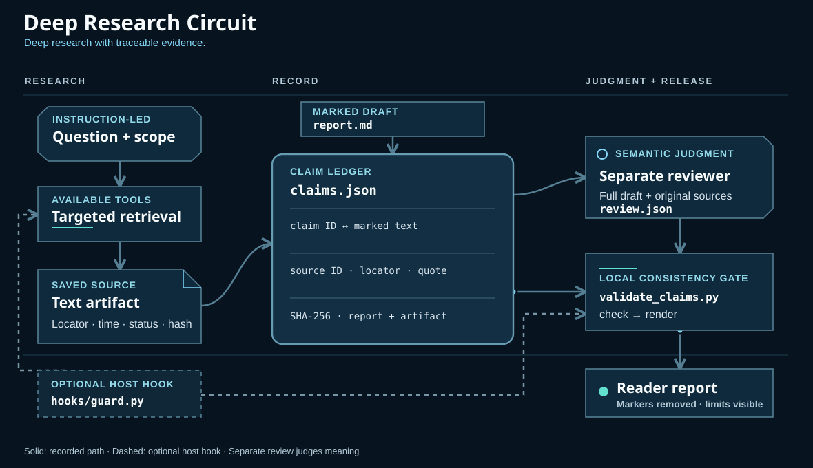

# Deep Research Circuit

Deep Research Circuit is a local research workflow for gathering evidence, recording claims and obtaining independent review. It combines subject-specific guidance, an offline claim/source consistency checker, and an optional Codex hook guard. It originated as the local Parham Deep Research 0.2.0 candidate and has been renamed for this release candidate.

**Prototype · Apache-2.0 · Python standard library.** The offline test suite and synthetic examples are reproducible without model calls or external services.



[Interactive architecture figure](docs/architecture/index.html) · [Source map](docs/architecture/architecture.md) · [Verification receipt](verification.json)

## What it does

- The explicitly invoked skill guides framing, source discovery, document recovery, subject-specific checks and independent review. Start at [SKILL.md](skills/deep-research-circuit/SKILL.md).
- The Python standard-library [validator](skills/deep-research-circuit/scripts/validate_claims.py) checks that a marked report, evidence records, hashes, quoted text and a recorded review agree.
- The optional [guard](skills/deep-research-circuit/references/automatic-guard.md) can count covered tool calls and run a final record check on supported Codex hook callbacks. It is not a sandbox or a universal output filter.

## Where it helps

The same evidence workflow supports different kinds of enquiry, with methods selected for the question:

- **Scientific and technical reviews:** trace findings to original papers, data, documentation and code; preserve uncertainty and contrary evidence.
- **Software and developer tools:** compare repositories, versions, capabilities and compatibility against actual requirements.
- **Legal and policy research:** check status, applicability and competing interpretations using the relevant jurisdiction's primary sources.
- **Business and quantitative analysis:** distinguish reported results from forecasts and assumptions; preserve calculations and their inputs.
- **Practical decisions:** compare products, travel options and property using current offers and authoritative records for the actual location.
- **History and mixed questions:** track source dependence, distinguish observation from inference, and follow decisive gaps across disciplines.

The workflow is international: source selection follows the country and jurisdiction of the enquiry. Domain guidance is research support, with its verification limits described below.

## Evidence boundaries

The validator **does not establish truth, source authenticity, quotation meaning, completeness or genuine reviewer independence**. A pass only checks the supplied records and recorded review. A human or suitably independent reviewer must inspect the report and evidence. The guard covers only callbacks delivered by the host and cannot retract generated text. Comparative research quality, speed, hallucination reduction and live host compatibility are unmeasured. See [claim-validation.md](skills/deep-research-circuit/references/claim-validation.md) for the record schema and limits.

## Try the synthetic example

Requires Python 3.9 or later and no external packages or network. Python 3.9 itself has not been tested. From the package directory:

```sh
python3 skills/deep-research-circuit/scripts/validate_claims.py check examples/synthetic/claims.json --review examples/synthetic/review.synthetic.json
python3 skills/deep-research-circuit/scripts/validate_claims.py render examples/synthetic/claims.json --review examples/synthetic/review.synthetic.json
python3 -m unittest discover -s tests
```

The example's source and review are fabricated; its review is a test record, not an independent assessment. Never use it to clear a real report. Tests run the guard as a subprocess with temporary local state; they do not register hooks, invoke providers or demonstrate activation in a live host.

The recorded local suite passed 59 tests on Python 3.15.2. A [proposed CI workflow](docs/ci/offline-checks.yml) is included for Python 3.9 and 3.15, but is not active: the publishing authorisation does not have GitHub's workflow scope. No hosted CI result is claimed.

## Optional hooks

The default [plugin.json](plugin.json) does **not** register hooks. The included [plugin.with-hooks.example.json](plugin.with-hooks.example.json) shows the additional hook declaration. Enabling it requires deliberately replacing the default manifest with that example before following the host's current plugin installation, permission and trust process. Do this only in an appropriate isolated test session after reviewing the scripts and host documentation. Installation or a manifest alone does not establish that callbacks fire. No installation or hook registration was performed for this candidate.

When hooks are loaded and trusted, the guard recognises a human prompt beginning with `$deep-research-circuit`, `Use Deep Research Circuit` or `Run Deep Research Circuit`. A human can end an active guard with `/drc end`; this does not mean the report passed. The guard has host and interception limits described in [automatic-guard.md](skills/deep-research-circuit/references/automatic-guard.md). The renamed version has only been exercised by offline simulated hook payloads, not by a live Codex session.

An active guard saves research evidence and work products beneath `<cwd>/research-workspaces/` and retains them after the run ends. Its SQLite state is stored under the host-provided `PLUGIN_DATA`. Choose an appropriate separate study directory and handle retained research files accordingly; the package directory and its descendants are rejected as study roots.

## Provenance and release review

See [PROVENANCE.md](PROVENANCE.md) and [source-sha256.txt](source-sha256.txt) for the source snapshot, changes and attribution.

Licensed under [Apache-2.0](LICENSE). Method adaptations are credited in their reference files and [NOTICE](NOTICE); fonts retain the licences included with their assets. This is an independent project, with no endorsement implied by a cited platform or method.
